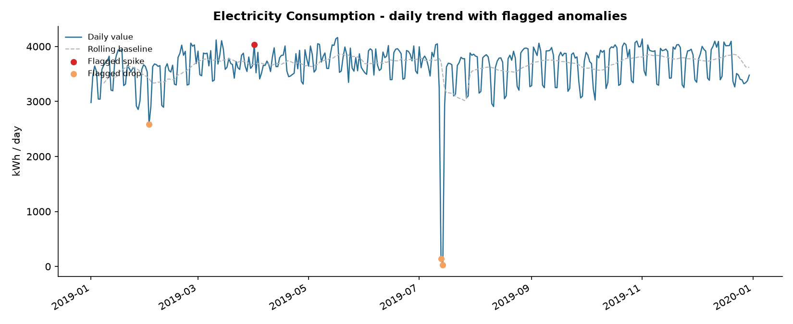

# Utility Consumption Anomaly Tracker

A small Python/Excel pipeline that ingests daily utility meter data (electricity, raw water,
and two modeled extensions for WTP/STP), flags anomalous days, and estimates the cost
impact — built around a facilities-operations task: **maintaining daily records of
utility consumption and identifying cost-saving opportunities.**

## What it does

For each of four daily consumption series, the pipeline:

1. **Loads and cleans** raw meter data — handling two real meter shapes (per-interval
   readings and cumulative running-total meters), including a data-quality check for
   non-monotonic ("meter reset") readings.
2. **Flags anomalous days** using two independent statistical methods: a rolling
   z-score (computed from the preceding window only, so it can't "see the future") and
   a global IQR cross-check, run in log-space for right-skewed series.
3. **Validates the detector** against deliberately-injected, known anomalies, so the
   project reports a measured precision/recall instead of just "it found some stuff."
4. **Estimates cost impact** of flagged spikes against an example utility tariff.
5. **Writes outputs**: an Excel workbook (`outputs/anomaly_report.xlsx`) with a summary
   sheet, a ranked cost-saving-opportunities sheet, and full per-metric detail — plus
   trend charts per metric.

Run the whole thing with:

```bash
pip install -r requirements.txt
python main.py
```

## Results (from the included dataset)

| Metric | Days analysed | Anomalies flagged | Est. cost impact* | Detector precision / recall** |
|---|---|---|---|---|
| Electricity consumption | 364 | 4 | $100.70 | 0.80 / 1.00 |
| Raw water consumption | 145 | 10 | $822.53 | 0.30 / 0.25 |
| WTP output (modeled) | 145 | 10 | $756.32 | 0.30 / 0.25 |
| STP treated volume (modeled) | 145 | 10 | $684.63 | 0.30 / 0.25 |

\* Example tariff rates only (AUD 0.28/kWh, AUD 3.50/kL) — **not** real billing rates;
see `main.py`. Swap in your own site's utility invoice rates before trusting any cost
figure for a real decision.

\*\* Measured by injecting a known number of deliberate spikes into a copy of the real
series and checking how many the detector catches vs. how many of its flags are real
(`src/modeling.py::validate_detector`). The electricity track — a full, continuous
year of real 15-minute data — validates well. The water-derived tracks validate more
modestly, which is a direct, honest consequence of how sparse the underlying water
meter readings are (see **Known limitations** below) — not a hidden problem.

These numbers regenerate from scratch every time you run `python main.py`; see
`outputs/summary.md` for the latest run.

### Sample chart



The detector catches a real ~2-day near-total outage in July 2019 and a couple of
smaller deviations, without flagging the normal day-to-day and weekday/weekend swing
as "anomalous" — that's the rolling-baseline design doing its job.

## Dataset & credits

Electricity and raw water readings come from a public sample of the **UNICON dataset**
(La Trobe University's Centre for Data Analytics and Cognition) — real 15-minute smart
meter data for one university campus.

- Dataset: https://www.kaggle.com/datasets/cdaclab/unicon
- Sample data + notebooks used here: https://github.com/CDAC-lab/UNICON
- Citation: H. Moraliyage, N. Mills, P. Rathnayake, D. De Silva and A. Jennings,
  "UNICON: An Open Dataset of Electricity, Gas and Water Consumption in a Large
  Multi-Campus University Setting," 2022 15th International Conference on Human
  System Interaction (HSI), 2022, pp. 1-8.

**On WTP/STP:** no public dataset of Water Treatment Plant or Sewage Treatment Plant
throughput exists at the facility level — that's internal operational data utilities
don't publish. To still cover all four utilities named in the brief, `src/modeling.py`
**derives** a WTP output series and an STP treated-volume series from the real raw
water series (fixed efficiency/return ratio + noise + a few injected anomalies). These
two are clearly synthetic and labeled "(modeled)" everywhere they appear — they
demonstrate the pipeline generalizes across metrics, not a claim of real WTP/STP
sensor data.

## Known limitations

- **Water track is sparse and irregular.** The underlying water meter is a cumulative
  counter that isn't read every day (gaps of 1–29 days in this sample). The pipeline
  converts that into an *average daily rate between readings* rather than treating a
  multi-day gap as a one-day spike — but this does produce a visible "sawtooth" shape
  in the raw-water chart for stretches with sparse readings (the rate ramps up as the
  gap since the last reading grows, then resets once readings resume). That's an
  artifact of the sampling, not of actual usage, and it's why the water-track
  precision/recall is lower than electricity's.
- **25 non-monotonic ("meter reset") readings** were detected in the raw water file
  and excluded from the consumption series rather than mis-counted as negative
  consumption — see the note at the top of `outputs/summary.md` for the exact count
  on your run.
- **Cost figures use a placeholder tariff.** Replace `RATE_ELECTRICITY_PER_KWH` /
  `RATE_WATER_PER_KL` in `main.py` with real billing rates before using these numbers
  for anything beyond demonstrating the method.
- **WTP/STP numbers are modeled, not measured** (see Dataset & credits above).

## Repository structure

```
.
├── data/raw/                      # real UNICON sample (electricity + water)
├── src/
│   ├── pipeline.py                # loading, cleaning, anomaly detection, cost impact
│   ├── modeling.py                # WTP/STP derivation + detector validation
│   └── visualize.py               # trend + anomaly charts
├── main.py                        # runs all four tracks end to end
├── outputs/                       # anomaly_report.xlsx, charts/, summary.md (generated)
├── notebook/exploratory_analysis.ipynb
└── requirements.txt
```

## Possible extensions

- Per-building/per-meter breakdown instead of campus-level aggregates
- Email/Slack alerting on newly-flagged anomalies (same idea as a prior EDA-agent
  project of mine — a natural next integration)
- A small Streamlit/Excel dashboard on top of `outputs/anomaly_report.xlsx`
- Swap the IQR/z-score pair for an Isolation Forest or seasonal-decomposition
  (STL) baseline, particularly for the water track's irregular sampling

## License

Code is MIT-licensed (see `LICENSE`). The dataset sample in `data/raw/` is from the
UNICON dataset — see **Dataset & credits** above for its own terms/citation.
